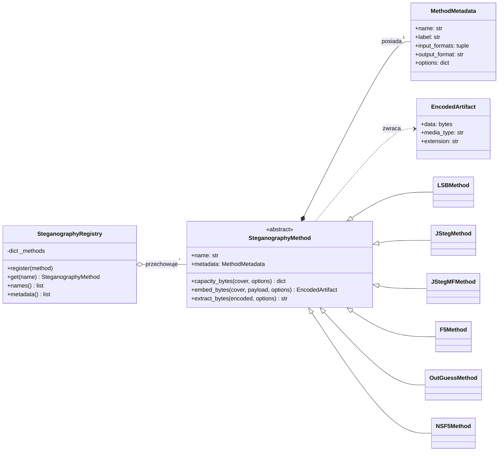
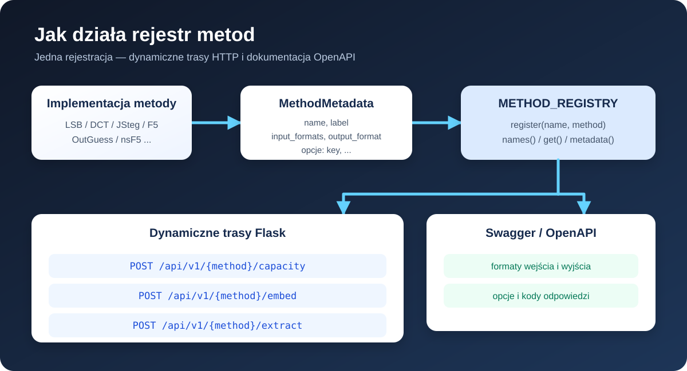
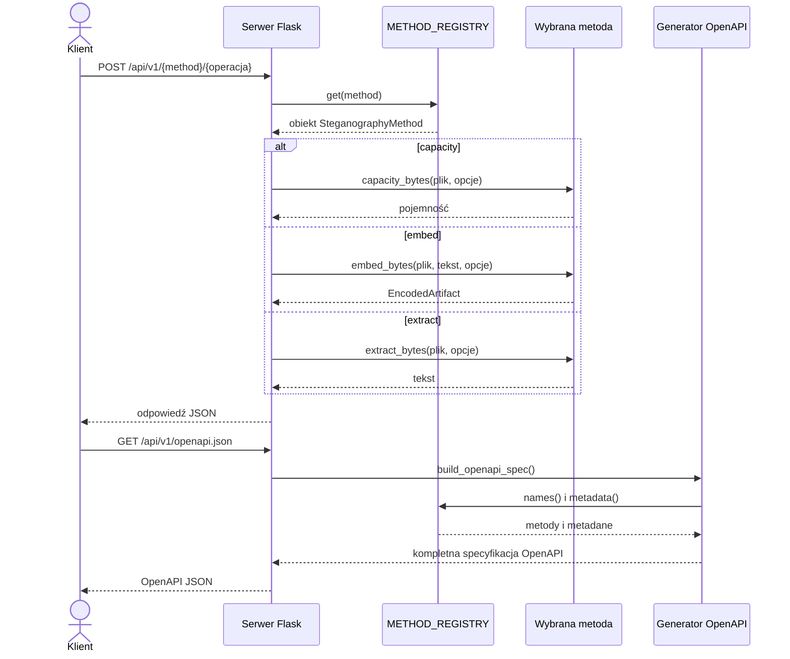
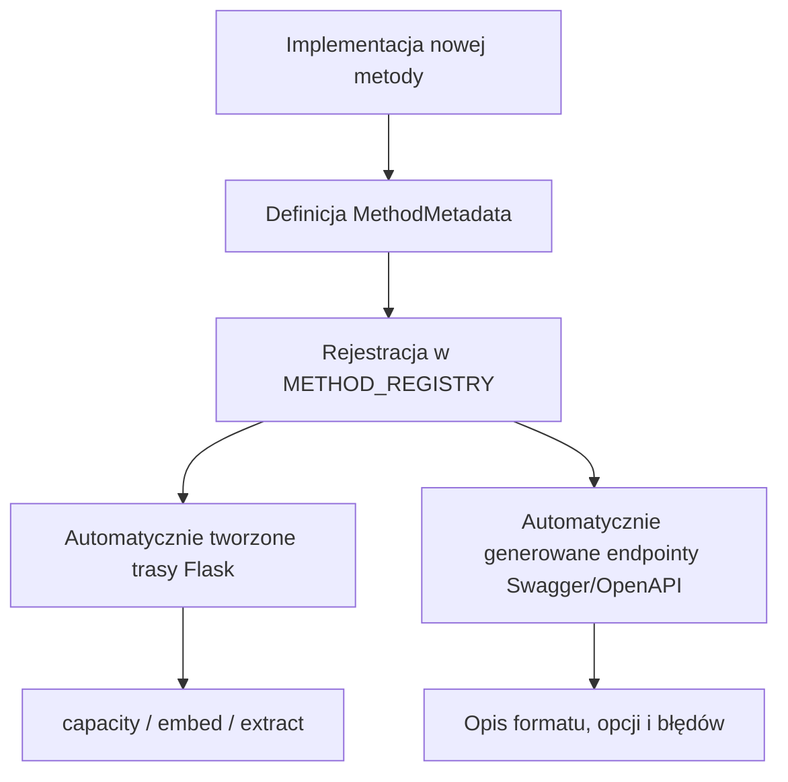

# UML i przebieg działania rejestru metod

Materiał prezentacyjny opisujący dynamiczne generowanie API i dokumentacji
Swagger/OpenAPI z `METHOD_REGISTRY`.

## Diagram klas

## Jak działa rejestr

Każda implementacja jest jednorazowo rejestrowana w globalnym obiekcie
`METHOD_REGISTRY`. Nazwa metody jest kluczem rejestru, a `MethodMetadata`
opisuje jej formaty wejścia i wyjścia oraz opcje, takie jak `key`.

Serwer Flask nie zawiera osobnych endpointów zapisanych dla każdej metody.
Dla każdej pozycji zwróconej przez `METHOD_REGISTRY.names()` rejestruje
dynamicznie trzy ścieżki:

- `POST /api/v1/{method}/capacity`
- `POST /api/v1/{method}/embed`
- `POST /api/v1/{method}/extract`

## Przepływ żądania HTTP

## Rozszerzalność

Dodanie metody wymagające rejestracji polega więc na implementacji kontraktu
`SteganographyMethod` i dodaniu jednej instancji do `METHOD_REGISTRY`.
Serwer i Swagger uzupełniają pozostałe elementy dynamicznie.

